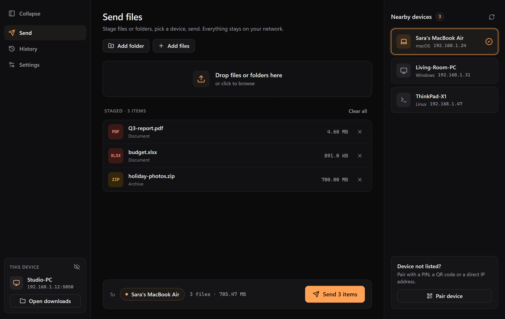
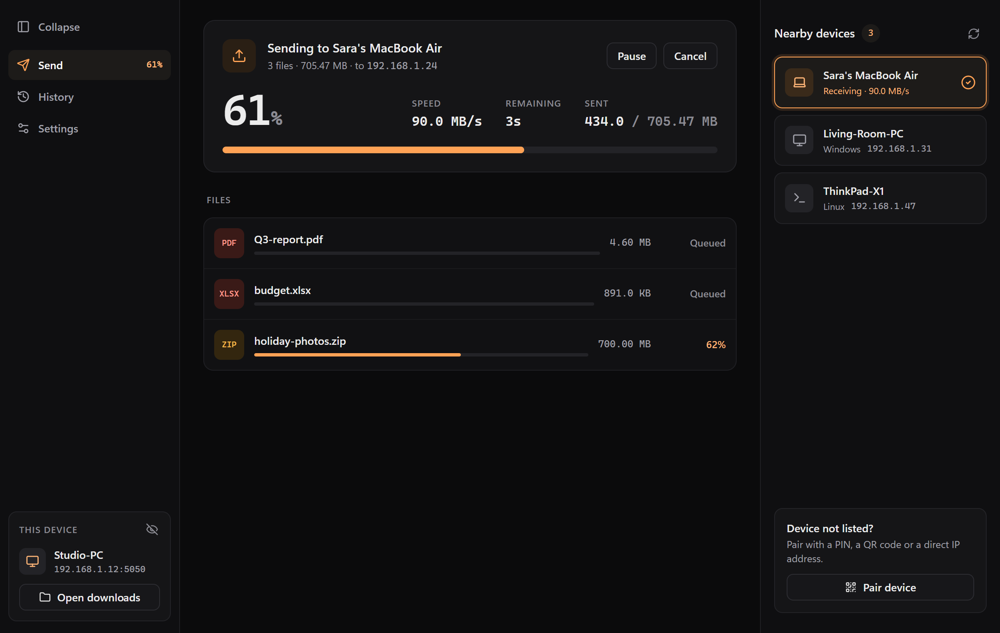
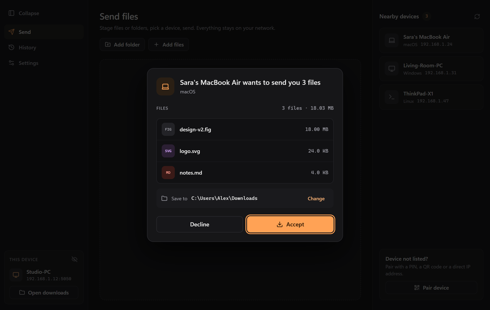
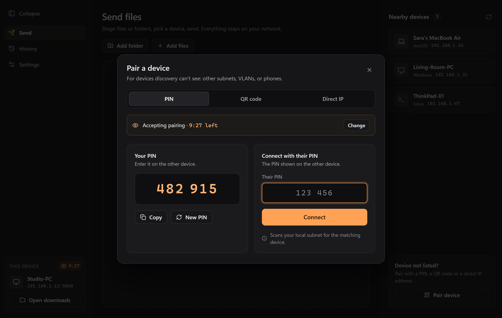
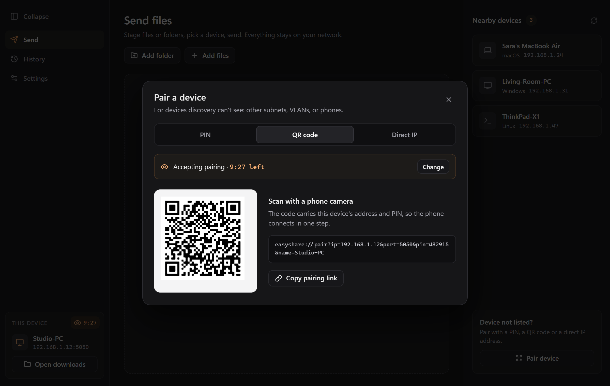
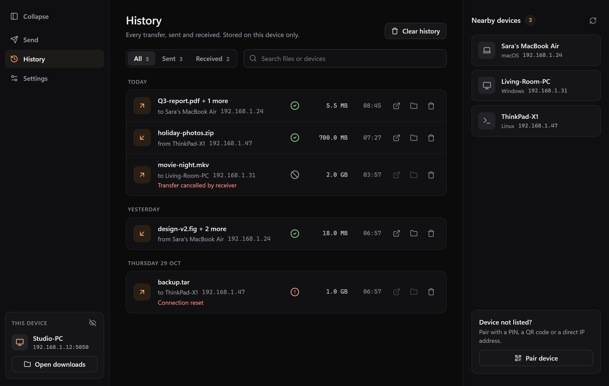
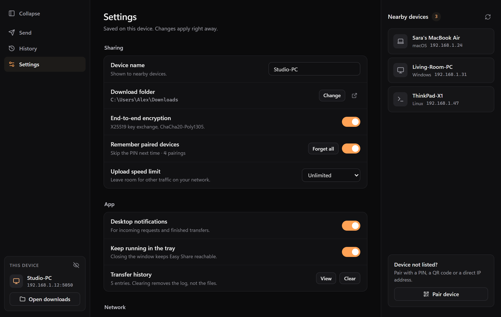

# Easy Share (v0.1)

A fast, lightweight and secure **local P2P file sharing desktop app** built with **Tauri 2** and **Rust**. Send files and folders between devices on the same network at full line speed, with no internet connection or cloud service involved.



---

## Screenshots

| Sending | Incoming request |
| :---: | :---: |
|  |  |
| **Pair with a PIN** | **Pair with a QR code** |
|  |  |
| **History** | **Settings** |
|  |  |

---

## Key Features

- **Rust core**: Tokio, Axum and Reqwest, with a small memory footprint and native throughput.
- **Automatic discovery**: mDNS (`_easyshare._tcp.local`) and UDP broadcast (port 41234) find devices on the local network with no setup.
- **PIN and QR pairing**: pair with a 6-digit PIN (`XXX - XXX`), a QR code or an `easyshare://pair?...` link, all generated on the device. The PIN is checked with SPAKE2 and never sent over the network.
- **Pairing only when you allow it**: pairing is off by default. Turn it on for 10 or 30 minutes from the eye icon on the device card or from the Pair dialog. Devices that aren't accepting pairing are never sent a pairing attempt.
- **Remembered devices** (optional): keep pairings across restarts and IP address changes. Pairings are stored by a stable device ID, and "Forget all" clears them.
- **End-to-end encryption** (on by default): X25519 key exchange per transfer and ChaCha20-Poly1305 for every chunk. Paired devices also mix the pairing key into the session key and prove they hold it. If encryption can't be set up, the transfer is refused rather than sent in plain text.
- **Works on restrictive networks**: a PIN search sweeps your local subnets when multicast and broadcast are blocked. Direct `IP`, `IP:Port` and URL connect reaches devices on other subnets.
- **Network adapter awareness**: physical Ethernet and Wi-Fi adapters are detected and ranked (Ethernet first). Virtual adapters (Docker, WSL, Hyper-V, Tailscale, VPNs) are ignored, and devices seen on several interfaces are shown once.
- **Resumable transfers**: files stream in 4 MB chunks and an interrupted transfer resumes from where it stopped.
- **BLAKE3 integrity**: every file is hashed and checked before it is saved.
- **Consent first**: the receiver sees the sender's name, OS and file list, and accepts or declines. A request with a bad key or pairing is declined before you are asked.
- **Folders and drag-and-drop**: drag files or whole folders into the window. Folder structure is kept on the receiving side.
- **Pause, resume and cancel**: the sender can pause and resume, and either side can cancel. A cancelled transfer deletes its partial files.
- **Upload speed limit**: 5, 10, 25 or 50 MB/s, or unlimited, changeable during a transfer.
- **Transfer history**: sent and received transfers, grouped by day, with search, filters and open/show-in-folder actions. Stored on the device only.
- **Tray and notifications**: keep running in the system tray with desktop notifications for incoming requests and finished transfers.
- **Single instance**: launching the app again brings the running window to the front.
- **Safe saving**: incoming file names are sanitized against path traversal. Files are written to a `.part` file first and never overwrite an existing file; a name clash gets a numbered name instead.

---

## Corporate & Enterprise Network Support

On many corporate, university and public Wi-Fi networks, normal discovery fails because of:
1. **AP client isolation**: the access point blocks broadcast and multicast traffic between wireless clients.
2. **mDNS and multicast filtering**: switches drop mDNS (`224.0.0.251`) and UDP broadcast packets.
3. **VLAN segmentation**: devices sit on different subnets that broadcast packets don't cross.

### How Easy Share handles this

Easy Share can connect devices directly over unicast HTTP:

1. **PIN search**:
   - The device you want to pair with turns pairing on and shows its PIN.
   - You enter that PIN. Easy Share sweeps the subnets of your physical adapters (Ethernet first, then Wi-Fi), probing up to 50 hosts at a time with a 400 ms timeout each.
   - Only devices that currently accept pairing are tried. The PIN is checked with SPAKE2, so a wrong guess learns nothing and the PIN never crosses the network.
   - A device accepts at most 5 attempts per minute and rotates its PIN after 10 failed attempts.

2. **QR code, pairing link or direct address**:
   - Scan the QR code, open the `easyshare://pair?ip=...&port=...&pin=...` link, or enter `IP:Port` directly.
   - Direct unicast HTTP works across routed subnets, so broadcast filters don't matter.

All pairing is **offline and LAN-only**: no signalling, STUN/TURN or other internet servers are contacted.

---

## Architecture & Tech Stack

- **Desktop framework**: [Tauri 2](https://tauri.app/)
- **Backend**: [Rust](https://www.rust-lang.org/) (2021 edition)
  - **Async runtime**: `tokio`
  - **HTTP server / client**: `axum` 0.8 / `reqwest` 0.12
  - **Pairing**: `spake2`
  - **Encryption**: `x25519-dalek`, `hkdf`, `chacha20poly1305`
  - **Hashing**: `blake3`
  - **Discovery**: `mdns-sd` and a `socket2` UDP broadcaster
  - **QR codes**: `qrcode`
- **Frontend**: vanilla JavaScript (ES modules), HTML and CSS, with [Lucide](https://lucide.dev/) icons

---

## Prerequisites

1. **Bun** (v1.0 or newer recommended): [Install Bun](https://bun.sh/) *(or Node.js v18+)*
2. **Rust & Cargo** (stable): [Install Rust](https://www.rust-lang.org/tools/install)
3. **Platform dependencies**:
   - **Windows**: Microsoft Visual Studio C++ Build Tools and WebView2 (pre-installed on Windows 10/11).
   - **macOS**: Xcode Command Line Tools (`xcode-select --install`).
   - **Linux**: `libwebkit2gtk-4.1-dev`, `build-essential`, `curl`, `wget`, `file`, `libssl-dev`, `libgtk-3-dev`, `libayatana-appindicator3-dev`, `librsvg2-dev`.

---

## Getting Started

### 1. Clone the repository
```bash
git clone https://github.com/SASA97A/P2P-File-Sharer-Easy-Share.git
cd P2P-File-Sharer-Easy-Share
```

### 2. Install frontend dependencies
```bash
bun install
```

### 3. Run in development mode
Opens the native Tauri window:
```bash
bun run dev
# or
bun run tauri dev
```

### 4. Build the production app
Compiles the optimized Rust backend and packages the installer:
```bash
bun run build
# or
bun run tauri build
```
The binaries and bundles (`.msi`, `.dmg`, `.deb`, `.AppImage`) are written to `src-tauri/target/release/bundle/`.

---

## Running Tests

Run the full Rust test suite:

```bash
cargo test --manifest-path src-tauri/Cargo.toml
```

Run a single suite with `--test <name>`:

| Suite | Covers |
| --- | --- |
| `pairing_test` | PIN and QR code generation |
| `scanner_test` | Subnet sweeping and address parsing |
| `client_test` | Handshakes, encryption negotiation, chunk streaming, cancel |
| `server_test` | HTTP endpoints, consent, pairing limits |
| `e2e_transfer_test` | End-to-end transfers and resumption |
| `crypto_test` | Key exchange and chunk encryption |
| `storage_test` | File naming, `.part` files and saving |
| `history_test` | Transfer history |
| `settings_test` | Settings persistence |
| `metrics_and_pause_test` | Throughput tracking, pause and resume |
| `discovery_test` | Discovery and adapter selection |
| `models_test` | Wire format |
| `app_state_and_commands_test` | App state and Tauri commands |

```bash
cargo test --manifest-path src-tauri/Cargo.toml --test client_test
```

---

## Security & Privacy

- **Local and offline**: transfers, pairing and discovery stay on your local network. No file content or metadata is sent to any external server.
- **Explicit consent**: nothing is received until you accept on the receiving device.
- **Encrypted by default**: each transfer gets a fresh X25519 key exchange and ChaCha20-Poly1305 encryption, with a separate key per file. A sender that asked for encryption refuses to fall back to plain text.
- **PIN never on the wire**: SPAKE2 pairing, a pairing window that is off by default, rate limits and automatic PIN rotation.
- **Verified files**: every file is checked against its BLAKE3 hash before it is saved.
- **Safe paths**: incoming names are sanitized against directory traversal, and existing files are never overwritten.
- **New PIN at any time**: generate a new PIN with one click to invalidate the old one.

---

## License

This project is licensed under the [MIT License](LICENSE).
